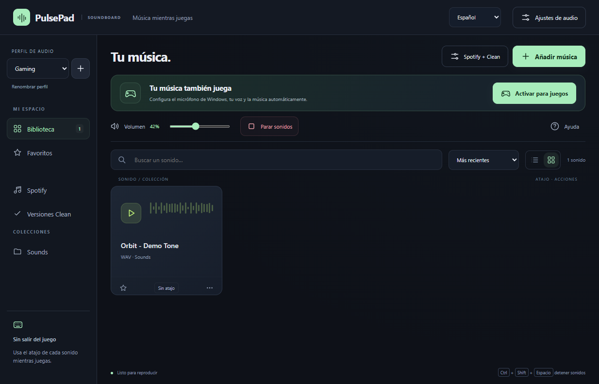

# PulsePad

**Tu música y tu voz en el mismo soundboard.** App local de Windows con mezcla de voz, atajos globales, perfiles y guía de micrófono.

[English](README.md) · [Descargar para Windows](https://github.com/zalomodev/PulsePad/releases/latest) · [Guía de voz + música](docs/GUIDE.es.md)



## Descargar e instalar

1. Abre [Releases](https://github.com/zalomodev/PulsePad/releases/latest).
2. Ejecuta **PulsePad-1.1.0-Setup.exe** para instalar en tu usuario. O descarga el ZIP x64, **extráelo completo** y abre `PulsePad.exe` dentro de la carpeta.
3. Elige **Español** o **English** arriba. La selección se guarda.
4. Pulsa **Añadir música** o arrastra archivos locales.

Requiere Windows 10/11 x64. Esta versión no tiene firma digital; Windows puede mostrar un aviso de editor desconocido. Instala solo versiones en las que confíes. No requiere cuenta. Las actualizaciones son manuales. La descarga no incluye canciones ni datos personales.

## Funciones

- Lista compacta con desplazamiento independiente o tarjetas, búsqueda, colecciones, favoritos y ordenación.
- MP3, WAV, FLAC, OGG/Opus y audio AAC/M4A/vídeo compatible con Electron. WMA, AIFF y MKV no están garantizados. No descarga enlaces ni admite DRM.
- Decodificación nativa a WAV de 48 kHz sin añadir compresión con pérdida. Originales intactos. Máximo 200 archivos por lote, 1 GB por origen y 256 MB decodificados por archivo (unos 11 minutos en estéreo).
- Volumen por sonido, bucle, pausa, desplazamiento y atajos disponibles `Ctrl+Alt+letra/número`. `Ctrl+Shift+Espacio` detiene sonidos.
- Salidas separadas para escucha y chat de voz, mezcla de micrófono opcional y compresor de picos.
- Guía de cuatro pasos con medidor y grabación temporal de seis segundos desde la entrada virtual seleccionada.
- Perfiles para dispositivos, niveles, vista y orden. Comparten canciones. Idioma y tamaño de ventana también se guardan.

## Usar en juegos

Necesitas un **dispositivo de audio virtual compatible** para enviar voz y música a otra app. PulsePad no es un controlador ni instala uno. La reproducción local funciona sin puente.

Usa **Steam Streaming Microphone** si ya existe y está activo, o instala un puente como [VB-CABLE](https://vb-audio.com/Cable/). Abre **Ayuda** y conecta auriculares. **Activar para juegos** selecciona un micrófono físico, activa la mezcla y cambia los tres roles predeterminados de captura de Windows al puente compatible elegido. Con VB-CABLE, usa **CABLE Input** aquí y **CABLE Output** como micrófono del juego.

Si el juego fija su entrada, elige **Predeterminado** o la entrada virtual. Reconecta un chat que ya estuviera abierto. Con pulsar para hablar, mantén esa tecla al poner sonidos. Desactivar o cerrar restaura los roles anteriores si aún apuntan al puente de PulsePad.

El micrófono y la transmisión empiezan **apagados** al iniciar o cambiar de perfil. **Parar sonidos** deja la voz activa; desactiva el micrófono o el modo juegos para silenciarla. Consulta la [guía completa](docs/GUIDE.es.md). No se garantiza un juego ni calidad remota específicos: influyen filtros, códecs y conexión.

## Datos, actualizaciones y otras PCs

Las instalaciones nuevas usan `%APPDATA%\PulsePad`. Las copias de esta versión comparten los datos del usuario y enfocan una sola ventana. PulsePad no sube canciones, ajustes ni grabaciones.

Las instalaciones del proyecto pueden conservar `user-library`. `%APPDATA%\PulsePad\storage-location.json` recuerda esa ubicación; no copies el puntero a otra PC. Las carpetas antiguas `data` se fusionan una vez por identificador sin borrar originales. Los EXE antiguos no obtienen esta mejora automáticamente: actualiza tus copias.

Para trasladar la biblioteca, cierra PulsePad y copia **toda la carpeta activa**, incluidos `library.json` y `audio`, a `%APPDATA%\PulsePad` en la nueva PC antes de abrir. No basta el EXE ni solo el JSON. Vuelve a elegir dispositivos; sus identificadores cambian. `library.backup.json` conserva el guardado anterior.

## Desarrollo

```powershell
npm ci
npm test
npm start
npm run dist
```

Usa Windows y Node.js 22+. `npm run build` genera una carpeta de prueba; `npm run dist`, instalador y ZIP en `release`. Las pruebas usan su propia biblioteca y un tono. `PULSEPAD_DATA` elige una carpeta aislada. `PULSEPAD_PACKAGED=1` prueba el EXE con `node scripts/smoke.cjs`.

La app usa el decodificador de Electron y no incluye FFmpeg. `ffmpeg-static` es una herramienta de desarrollo para pruebas antiguas y queda fuera de las descargas.

[Contribuir](CONTRIBUTING.md) · [Avisos de terceros](THIRD_PARTY_NOTICES.md) · [Licencia MIT](LICENSE)

## Beta 1.2: Spotify + Clean

[Prueba la beta](https://github.com/zalomodev/PulsePad/releases/tag/v1.2.0-beta.1) con sugerencias de la app de Spotify y copias Clean separadas para archivos locales. Los accesos reproducen externamente, sin OAuth ni descargas. El automático empieza apagado, solo admite modelos de coste cero de OpenCode y nunca cambia a uno de pago. La prueba real encontró cuota gratuita agotada; el marcado manual y la edición local siguen disponibles. Lee la [guía completa en español](docs/SPOTIFY-CLEAN.es.md).
