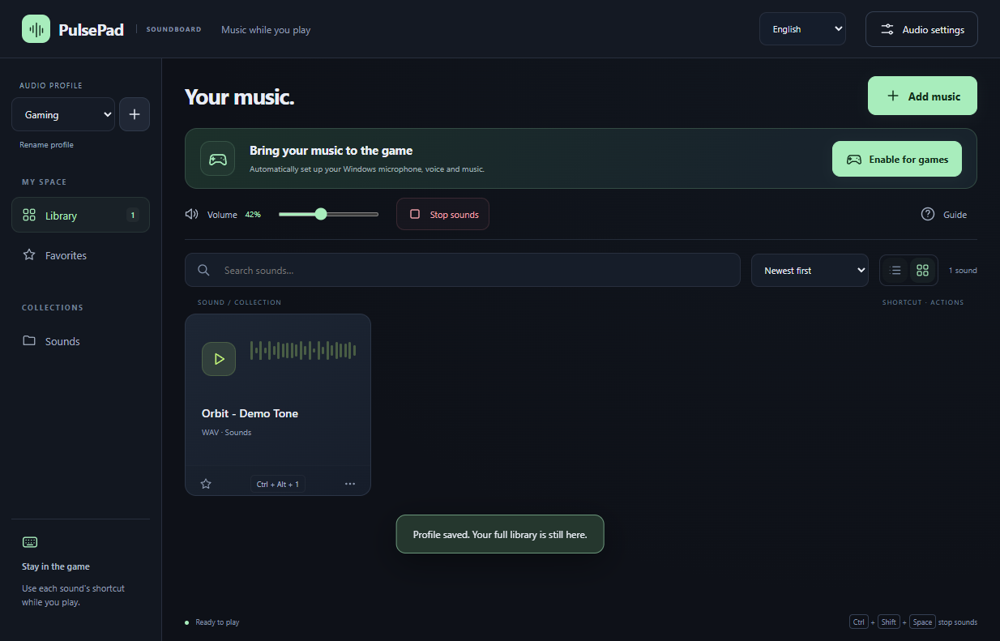

# PulsePad

**Your music, your voice, one soundboard.** Local Windows app with voice mixing, global shortcuts, audio profiles and a microphone test guide.

[Español](README.es.md) · [Download for Windows](https://github.com/zalomodev/PulsePad/releases/latest) · [Voice + music guide](docs/GUIDE.en.md)



## Download and install

1. Open [Releases](https://github.com/zalomodev/PulsePad/releases/latest).
2. Run **PulsePad-1.1.0-Setup.exe** to install for your Windows user. Alternatively, download the x64 ZIP, **extract it completely**, then run `PulsePad.exe` inside it.
3. Select **English** or **Español** in the top bar. The choice is saved.
4. Click **Add music** or drag local files into the window.

Requires Windows 10/11 x64. This release is unsigned; Windows may show an unknown-publisher prompt. Only install a release you trust. No account required. Updates are manual. No songs or personal data are included in the download.

## Features

- Compact scrolling list or cards, search, collections, favorites and sorting.
- MP3, WAV, FLAC, OGG/Opus and supported AAC/M4A/video audio imports, depending on Electron's codecs. WMA, AIFF and MKV are not guaranteed. No streaming downloads or DRM support.
- Native decoding to 48 kHz WAV without another lossy encode. Source files stay unchanged. Limits: 200 files per batch, 1 GB per source, 256 MB decoded per file (about 11 minutes of stereo audio).
- Per-sound volume, looping, pause, seeking, and available `Ctrl+Alt+letter/number` shortcuts. Stop sounds with `Ctrl+Shift+Space`.
- Separate local listening and voice-chat outputs, optional physical microphone mixing and peak compression.
- Four-step guide with a voice meter and a temporary six-second recording from the selected virtual input.
- Profiles save devices, levels, layout and sorting; all profiles share songs. Language and window size are remembered.

## Use with games

A **compatible virtual audio device** is needed to send voice and music into another app. PulsePad is not an audio driver and does not install one. Local playback works without a bridge.

Use **Steam Streaming Microphone** if already active, or install a bridge such as [VB-CABLE](https://vb-audio.com/Cable/). Open **Guide** and connect headphones. **Enable for games** selects a physical microphone, enables the mix, and switches Windows' three default recording roles to the selected supported bridge. With VB-CABLE, use **CABLE Input** here and **CABLE Output** as the game's microphone.

Games with a fixed input must select **Default** or the corresponding virtual input. Reconnect an already-open voice chat. With push to talk, hold that key while playing sounds. Disable game mode or close the app to restore previous microphone roles if they still point to PulsePad's bridge.

Capture and broadcast start **off** on launch and after profile switching. **Stop sounds** leaves voice active; disable the microphone or game mode to mute voice. See the [English guide](docs/GUIDE.en.md) or [Spanish guide](docs/GUIDE.es.md). No specific game or remote-call quality is guaranteed; codecs, filters and connection affect the result.

## Data, updates and moving PCs

New installations use `%APPDATA%\PulsePad`. Copies of this version share per-user data and focus one existing window. PulsePad does not upload songs, settings or recordings.

Existing project installs can retain `user-library`. `%APPDATA%\PulsePad\storage-location.json` records that location; do not copy this pointer to another PC. Legacy `data` folders are merged once by track ID, preserving originals. Old executables do not gain shared storage automatically: update your copies.

To move your library, close PulsePad and copy the **entire active data folder**, including `library.json` and `audio`, into `%APPDATA%\PulsePad` on the new PC before launching. Copying only the EXE or JSON does not move songs. Reselect devices because their IDs change. `library.backup.json` holds the previous save.

## Develop

```powershell
npm ci
npm test
npm start
npm run dist
```

Use Windows and Node.js 22+. `npm run build` creates an unpacked app; `npm run dist` creates an NSIS installer and ZIP under `release`. Tests use an isolated library and demo tone. `PULSEPAD_DATA` selects an isolated data folder. `PULSEPAD_PACKAGED=1` tests the built EXE with `node scripts/smoke.cjs`.

The app uses Electron's decoder and ships no FFmpeg binary. `ffmpeg-static` is development-only tooling for legacy test helpers, excluded from releases.

[Contributing](CONTRIBUTING.md) · [Third-party notices](THIRD_PARTY_NOTICES.md) · [MIT license](LICENSE)
